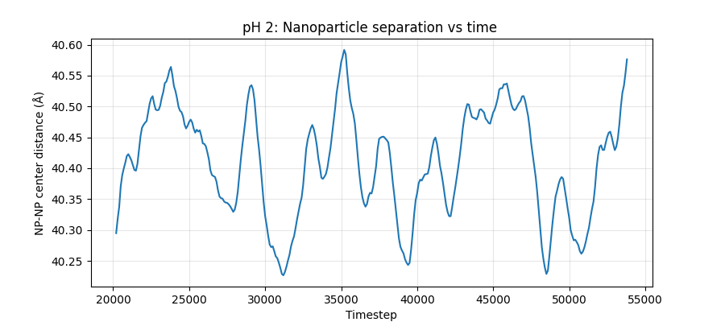
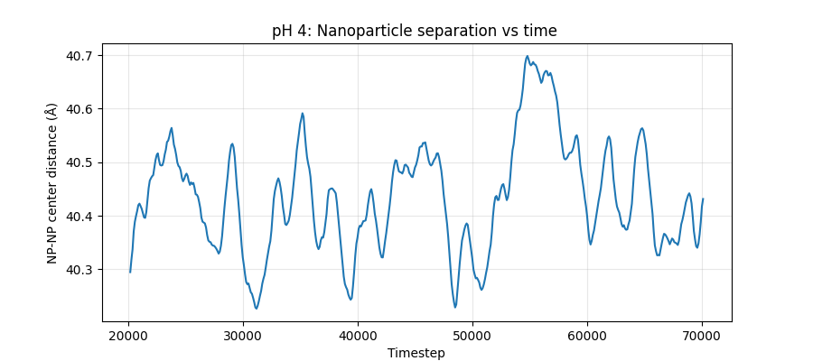
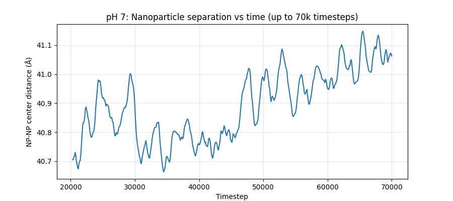
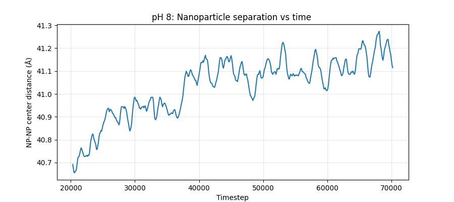
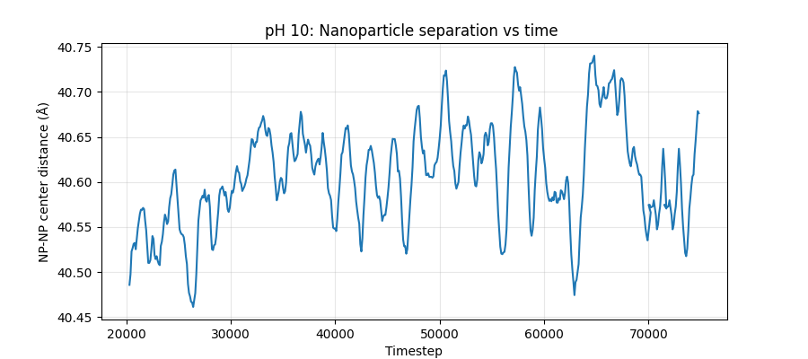
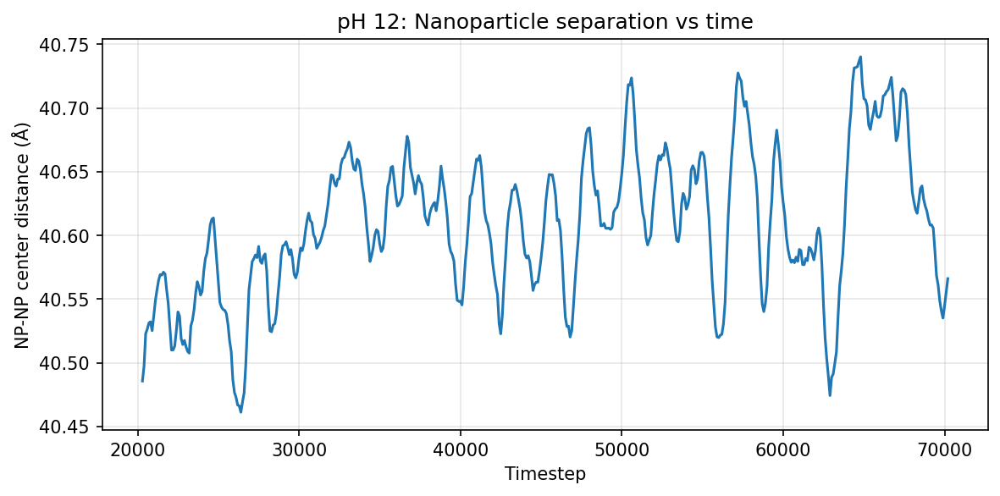
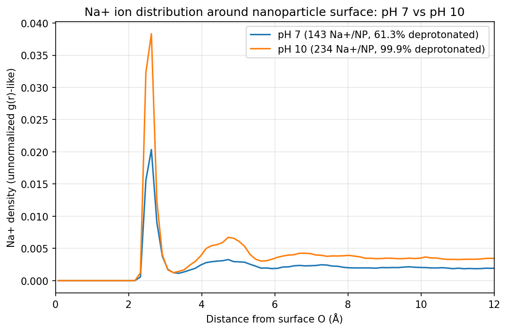
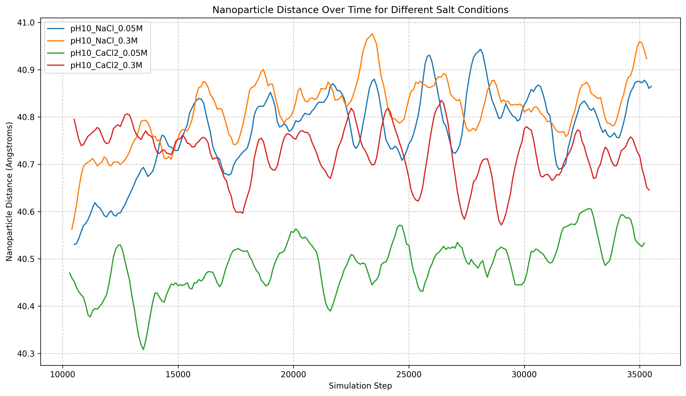

# Effect of pH and Salt on the Aggregation of Silica Nanoparticles in Water

Molecular dynamics (LAMMPS) study of two 3 nm crystalline silica (α-quartz) nanoparticles in explicit water, using the CLAYFF force field and SPC water. Surface charge is set from pH, and background salt (NaCl, CaCl₂) is added at pH 10. The observable is the centre-of-mass distance between the two particles over time.

> **Scope in one line:** a qualitative, single-trajectory model study of how surface charge and ions affect the force between two silica particles. It is not a quantitative prediction. See [Limitations](#limitations).

## Problem

Whether fine silica stays dispersed or aggregates in water depends on its surface charge (set by pH) and on ionic screening (set by salt type and concentration). This governs slip behaviour and packing in ceramic processing and, in particular, the gelation and deflocculation of colloidal silica and microsilica in **refractory castables**, where the pore water is at pH 11–12 and contains Ca²⁺ from calcium aluminate cement.

Question: *how do surface charge (pH) and added ions change the interaction between two silica nanoparticles in water?*

## Method

| Step | What | Script |
|---|---|---|
| 1 | Cut a 3 nm sphere from an α-quartz CIF, cap broken bonds with silanol (Si–OH). 1497 atoms, 234 surface silanols per particle | `01_build_nanoparticle.py` |
| 2 | Assign CLAYFF charges; deprotonate silanols with fraction 1/(1+10^(pKa−pH)), pKa = 6.8; one Na⁺ per site | `02_assign_pH_charges.py` |
| 3 | Place two particles 40 Å apart, fill with SPC water + Na⁺ (Packmol), write LAMMPS data files | `03_build_system_and_solvate.py` |
| 4 | LAMMPS inputs: minimise → Langevin 10→300 K (20 ps) → NVT 300 K (35–55 ps), SHAKE water, PPPM | `04_generate_lammps_inputs.py` |
| 5 | Na⁺ distribution around the surface (pH 7 vs pH 10) | `05_na_rdf_analysis.py` |
| 6 | Salt study at pH 10: NaCl / CaCl₂ at 0.05 and 0.3 M | `06_salt_concentration_study.py` |
| 7 | Plots and drift statistics | `07_plot_results.py` |
| 8 | Visualisation in OVITO | `08_visualize_ovito.py` |

`run_all.sh` chains the whole pipeline. Requirements: Python (`requirements.txt`), Packmol, LAMMPS with OPENMP. The study was run on a free Google Colab CPU runtime (2 OpenMP threads).

Force field: CLAYFF Si–O framework, harmonic O–H, SPC water with SHAKE, arithmetic mixing, 10 Å cutoff, PPPM 1e-4. Cl⁻ and Ca²⁺ parameters are borrowed from other ion models.

## Results

| pH | Deprotonated sites / particle | Observed separation drift |
|---|---|---|
| 2 | 0 of 234 | ≈ 0 (oscillation only) |
| 4 | 0 of 234 | ≈ 0 (identical system to pH 2) |
| 7 | 143 (61%) | ≈ +0.36 Å |
| 8 | 220 (94%) | ≈ +0.4 Å |
| 10 | 234 (99.9%) | ≈ +0.08 Å |
| 12 | 234 (100%) | ≈ +0.08 Å (identical system to pH 10) |

Because the charge model saturates, the six pH values contain **four distinct charge states**; the pH 4 and pH 12 runs reproduce the pH 2 and pH 10 traces and act as repeat runs.

| | |
|---|---|
|  |  |
|  |  |
|  |  |

**Counterions.** The first Na⁺ peak around the surface oxygens is taller at pH 10 (0.038) than at pH 7 (0.020) (unnormalised). This is consistent with stronger counterion binding at the more highly charged surface, which would reduce the net repulsion, but it does not prove it.



**Salt (pH 10).** NaCl and CaCl₂ at 0.05 and 0.3 M (3 and 21 ion pairs; 10 ps + 25 ps) stay within 40.3–41.0 Å and overlap. No consistent dependence on concentration or valence was resolved.



## Limitations

- **Surface charge density is too high** (~8 e/nm² vs about 1–2 e/nm² or less for real silica).
- **Small periodic box** (~12 Å from a particle to its own image in y and z); image interactions reduce the observed drift.
- **Short single runs** (35–55 ps). Drifts of 0.1–0.4 Å are comparable to the thermal fluctuation (0.2–0.4 Å); no error bars.
- **pH is a fixed-pKa lookup.** It saturates (pH 10 = pH 12, pH 2 = pH 4) and ignores site heterogeneity.
- **No low-pH stability mechanism.** Real silica near its isoelectric point (pH 2–3) is stable through hydration forces; the model shows no net force there, not aggregation.
- **Salt study is underpowered:** 3–21 ion pairs on top of ~6 M of neutralising Na⁺ in the free volume, with borrowed Cl⁻/Ca²⁺ parameters.
- The pH 8 result cannot be separated from pH 7 and pH 10.

## Next steps

Realistic charge density (1–2 e/nm²), larger box, potential of mean force by umbrella sampling, replicas with error bars, fitted ion parameters, and comparison with zeta-potential or castable gelation data.

## Contents

```
README.md
01_build_nanoparticle.py ... 08_visualize_ovito.py   pipeline scripts
run_all.sh                                           runs the whole pipeline
quartz_relaxed.cif                                   input structure (alpha-quartz)
np_distance_pH*.png, na_rdf_comparison_pH7_pH10.png, salt_comparison.png   result figures
Silica_NP_pH_Salt_Detailed_Report.pdf                8-page report
Silica_NP_pH_Salt_2page_Summary.pdf                  2-page summary
```

Install the Python packages with `pip install numpy scipy ase matplotlib`. Packmol and LAMMPS (with the OPENMP package) are installed separately.

## References

1. Yaghoubi et al., *Iran. J. Mater. Sci. Eng.* 9(2), 2012 – nano silica in ultra-low cement castables (Ca²⁺ and Al³⁺ from cement can act as gelling agents).
2. Badiee and Otroj, *Ceramics–Silikáty* 53(4), 297–302, 2009 – nano-silica sol bonded non-cement castables.
3. Smedes et al., *Ceramics International* 51(27), 52688–52695, 2025 – pH/temperature control of coagulation in colloidal silica zero-cement castables.
4. Cygan, Liang and Kalinichev, *J. Phys. Chem. B* 108, 1255, 2004 – CLAYFF force field.
5. Iler, *The Chemistry of Silica*, Wiley, 1979.

```
